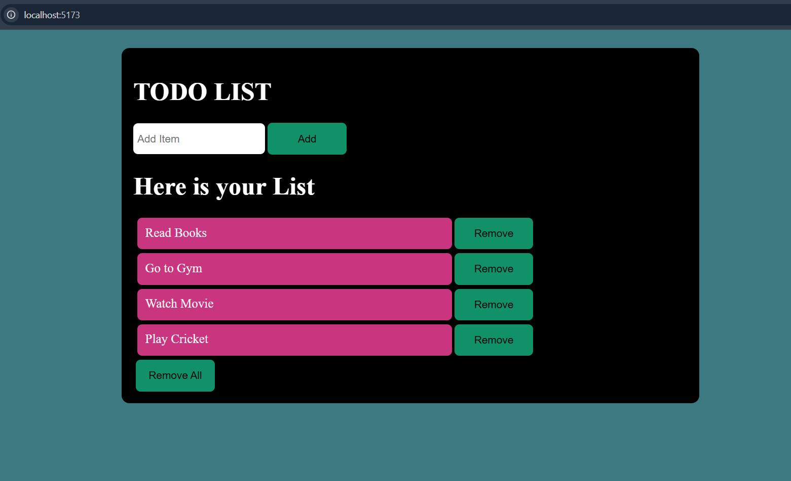

# Todo List App – React

This is my first mini project built using React. I made this project while learning React and trying to put the concepts I had learned into practice.

## Features

- Add new tasks to the list.
- Remove individual tasks.
- Remove all tasks at once.
- Clear the input field after adding a task.
- Display the updated list whenever a task is added or removed.

## Tech Stack

- React
- JavaScript
- HTML
- CSS
- Vite

## Screenshot



## What I Learned

While building this project, I got hands-on experience with some basic React concepts:

- **useState:** Managing input values and the todo list.
- **Event Handling:** Handling input changes and button clicks using `onChange` and `onClick`.
- **Rendering Lists:** Using `map()` to display todos dynamically.
- **Removing Items:** Using `filter()` to remove a particular item from the list.
- **State Updates:** Understanding how to update state using both direct and functional state updates.
- **Keys in React:** Understanding why keys are needed when rendering lists.

## Learning Resource

As a beginner, I know how difficult it can be to find good learning resources. There is so much content available that sometimes you end up spending more time switching between tutorials than actually learning.

If you're also starting with React and prefer short, precise explanations instead of long tutorials, followed by learning through building things yourself, I'd genuinely recommend this playlist.

**[React Tutorial Playlist](https://www.youtube.com/playlist?list=PLp18NAIKHWnvpLpioGs6ZAiMlpfx49KOzE)**

Just to be clear, this isn't a promotional recommendation or a sponsored mention. I simply found the playlist helpful and wanted to share it with other beginners who might be facing the same difficulty finding the right resources.

One suggestion before starting React: make sure you have a decent understanding of JavaScript and the basics of HTML and CSS. It will make learning React much easier.

## Running Locally

1. Clone this repository:

   ```bash
   git clone https://github.com/Rohitkashyap-22/React-Todo-List
   ```

2. Navigate to the project folder:

   ```bash
   cd Task-01-Todo List
   ```

3. Install dependencies:

   ```bash
   npm install
   ```

4. Start the development server:

   ```bash
   npm run dev
   ```

## Final Note

This is a small project, but it was a good starting point for my React journey. I learned a lot by actually writing the code, fixing errors, referring to documentation, and figuring things out along the way.

Looking forward to building more projects and learning new things!